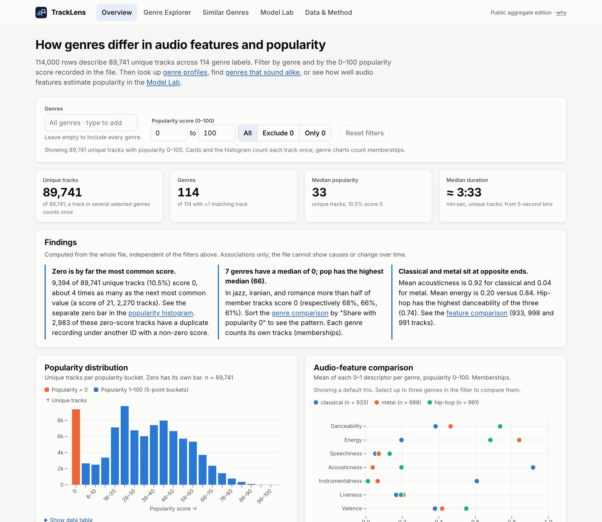

# TrackLens

An interactive music-analytics dashboard built on a 114,000-row track dataset. It answers three questions:

1. **How do genres differ** in audio features and recorded popularity?
2. **Which tracks sound similar** based on their measured audio features?
3. **How well can audio features estimate** the popularity score in this dataset? (Answer: a little better than a constant baseline.)

**Live demo:** _added once the GitHub Pages deployment is verified._



## What is in it

| View | Public edition (GitHub Pages) | Local full-data edition |
| --- | --- | --- |
| **Overview** | Unique-track cards, popularity histogram with a separate zero bucket, sortable genre comparison, three-genre feature comparison, genre and popularity filters kept in the URL, three findings computed from the data | Same |
| **Explorer** | Genre Explorer: search, filter, sort and page through 114 genre profiles, a genre map and a detail panel | Track Explorer: case- and accent-insensitive search by title, artist or album; genre, popularity and audio-feature filters; sorting; pagination; a density plot of every matching track; a detail panel with similar tracks |
| **Similar** | Similar Genres (genre centroids); track-level search is turned off with a short explanation | Find Similar Tracks: k-nearest neighbours on z-scored audio features in a Web Worker, with plain-language explanations |
| **Model Lab** | Edit validated audio features or start from a genre's medians; held-out metrics, baseline comparison, actual vs predicted, residuals, error by popularity band, permutation importance | Also loads any track's features and shows whether it was in the training split |
| **Data & Method** | Profile, cleaning rules, denominators, limitations, model card summary, publication notes | Same |

### Why there are two editions

The CSV is a widely mirrored "Spotify Tracks Dataset" compilation. Its mirrors list conflicting licences (BSD on Hugging Face, CC0 on a Kaggle mirror), and the data was originally retrieved from Spotify's Web API. Spotify's Developer Terms restrict redistributing that content. Permission to republish track-level records could not be established, so:

* the **public build is aggregate-only**: genre statistics, counts per (genre combination, popularity score, 5-second duration bin), scaler and model parameters, held-out evaluation summaries, and synthetic test fixtures;
* the raw CSV and every track-level file stay in git-ignored folders (`data/raw/`, `web/local-data/`, `web/dist-full/`). `scripts/check-dist.mjs` fails the build if any of them reaches `web/dist`, and `pipeline/tests/test_publication.py` checks that no track ID appears in a published file.

Spotify's current Developer Policy also prohibits using Spotify content to train machine-learning models. This project trains its model on a third-party copy of the data, but that policy may still apply to your use. Check it before reusing the model or this pipeline.

## Results (held-out test split)

All numbers come from the last training run (`docs/model-card.md`, `web/public/data/model-eval.json`).

| Model (best configuration per family) | Validation MAE | Test MAE | Test RMSE | Test R² |
| --- | --- | --- | --- | --- |
| Median baseline (always predicts 34) | 17.01 | 17.22 | 20.58 | −0.002 |
| Ridge regression (one-hot key and time signature) | 16.43 | 16.58 | 20.16 | 0.038 |
| **Histogram gradient-boosted trees, absolute-error loss (selected)** | **15.02** | **15.22** | **19.50** | **0.100** |

* Selected by validation MAE across 14 configurations; the test split (13,451 tracks) was used only for the numbers above.
* **Test MAE 15.22 vs 17.22 for the baseline (11.7% lower), R² 0.10.** Audio features carry some signal, but most of what drives this score is not in the file.
* Errors are largest at the extremes. Tracks with an observed score of 0 have a mean prediction of 32.9, and the 81 test tracks scoring 81–100 have an MAE of 45.3. 90% of test predictions fall between 16 and 46.
* Permutation importance on the test split ranks instrumentalness, acousticness, valence and danceability highest. This shows what the model relies on, not what causes popularity.

### Limitations

* Popularity is a single snapshot score with no collection date. The file has no release dates, play counts or listener data.
* The sample has about 1,000 rows per genre label, so genre sizes reflect the sampling, not real-world prevalence.
* Audio features cannot capture artist audience, promotion, playlist placement, release timing or market.
* Duplicate recordings are kept on one side of the split when their normalised artist and title match, or when all audio features match exactly. Remasters with changed titles, covers and differently credited versions can still cross the split.

## Data processing in brief

Details: [`docs/data-notes.md`](docs/data-notes.md) (generated by the pipeline).

* 114,000 rows → **89,741 canonical tracks** (one per `track_id`) plus **113,550 unique track–genre memberships**. 450 exact repeats of a track–genre pair were dropped; every genre membership is kept.
* Only `popularity` ever disagrees between rows of the same ID (720 IDs). The canonical value is the median of that ID's rows, rounded half up, so the result does not depend on row order.
* **Zeros are valid** and kept: 16,020 zero rows, 9,394 zero-score unique tracks (10.5%). Every histogram shows zero as its own bucket. 2,983 zero-score tracks have a duplicate recording under another ID with a non-zero score.
* One row has 0 ms duration and no title, artist or album. It is counted, but excluded from the model and similarity search.
* Charts say what they count: **unique tracks** (cards, histogram, Track Explorer; a track in several selected genres counts once) or **track–genre memberships** (genre charts).

## Similarity method

Euclidean distance on nine z-scored audio features: danceability, energy, loudness, speechiness, acousticness, instrumentalness, liveness, valence and tempo. The `StandardScaler`-style mean and scale are fitted on all model-valid canonical tracks and published in `similarity.json`. Track identity, popularity, genre, duration, key, mode and time signature are excluded. Results exclude the query track and its duplicate recordings, and list each title–artist pair once. Explanations name the features on which the two tracks agree and the query is distinctive, plus the largest difference. Similarity describes how close the measured audio features are, not listener preference.

## Model export and parity

The selected model's trees, feature order, validation bounds and 0–100 clipping rule are exported to `web/public/data/model.json` (a deterministic JSON tree format, about 125 kB gzipped). Python evaluation and the browser apply the same validation and clipping. Parity tests compare scikit-learn, a pure-Python evaluator of the JSON (`pipeline/tests/test_modeling.py`) and the TypeScript evaluator (`web/src/lib/model.test.ts`) on 95 fixed synthetic inputs, to a tolerance of 1e-9. The inputs include training medians, every bound edge, seeded random vectors and values placed exactly on, and one float above, tree split thresholds.

## Local setup

Requirements: Python 3.14 and Node 22 or newer.

```bash
git clone https://github.com/abu166/tracklens.git
```

```bash
cd tracklens/web && npm ci && npm run dev
```

A clean clone builds and runs the **public edition** from the committed artifacts in `web/public/data`. No CSV is needed.

### Rebuild the data and retrain the model

Place the dataset at `data/raw/dataset.csv` (git-ignored), then from the repository root:

```bash
python3 -m venv .venv && .venv/bin/pip install -r pipeline/requirements.lock.txt
```

```bash
.venv/bin/python pipeline/build.py
```

This takes about 30 seconds on a laptop. It regenerates:

* `web/public/data/*.json`: aggregate artifacts (committed and published)
* `web/local-data/tracks.json`: the track-level table (git-ignored; local only)
* `web/src/lib/__fixtures__/parity.json`: synthetic parity fixtures
* `docs/data-notes.md` and `docs/model-card.md`

Every artifact records the CSV's sha256 and a schema version. The split, model and fixtures use a fixed seed (42), so reruns are reproducible.

### Run the local full-data edition

```bash
cd web && npm run dev:full
```

Or build it with `npm run build:full` and serve it with `npm run preview:full`. Output goes to `web/dist-full/`, which is git-ignored and never deployed.

### Tests and checks

```bash
.venv/bin/python -m pytest -q pipeline/tests
```

```bash
cd web && npm run typecheck && npm test && npm run build && npm run check:dist
```

`check:dist` prints the build size and fails if restricted files, unexpected data files or asset paths outside `/tracklens/` reach `web/dist`.

## Deployment

`.github/workflows/pages.yml` runs on every push to `main`. It installs locked dependencies (`npm ci` and `requirements.lock.txt`), runs the Python tests, type-checks, runs the unit tests, builds with `BASE_PATH=/<repo>/`, checks the build, and deploys `web/dist` to GitHub Pages. Deep links work because the build copies `index.html` to `404.html`, and React Router runs under the repository subpath.

## Project layout

```
pipeline/            offline Python pipeline (pandas, scikit-learn) and tests
  build.py           entry point: profile → canonicalise → aggregates → train → export → docs
  tracklens/         data.py, aggregates.py, modeling.py, report.py, config.py
web/                 React + TypeScript + Vite front end (Observable Plot charts)
  public/data/       published aggregate artifacts
  src/lib/           typed loaders, selectors, model evaluator, worker, tests
  src/views/         Overview, Explorer (genre/track), Similar, Model Lab, Data & Method
  scripts/           postbuild (404.html) and check-dist
docs/                generated data notes and model card, screenshot
```

## Attribution

Data: the "Spotify Tracks Dataset" compilation (114,000 rows, 114 genres) as supplied to this project. Track metadata and audio features were originally retrieved from Spotify's Web API. TrackLens is not affiliated with or endorsed by Spotify. The MIT licence in `LICENSE` covers the code only.

## CV bullet

> Built TrackLens, a React/TypeScript and scikit-learn analytics app over a 114k-row music dataset. Canonicalised it to 89,741 tracks and trained a gradient-boosted popularity model on a duplicate-aware split (test MAE 15.2 vs 17.2 for the median baseline, R² 0.10). Exported the model to JSON with 1e-9 Python/browser parity, and shipped an aggregate-only GitHub Pages build with CI checks that keep restricted track data out.
